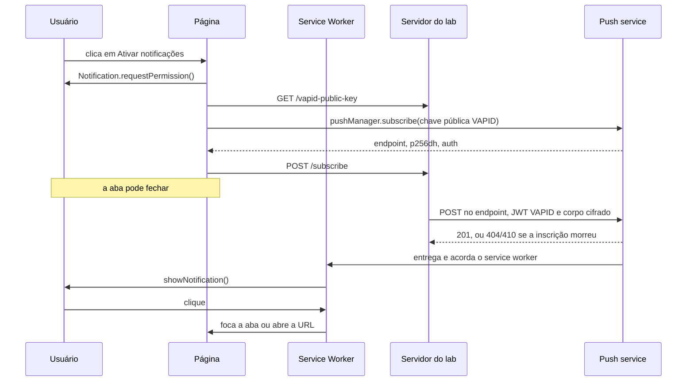

# Lab: Web Push com VAPID

Um laboratório pequeno para ver, com as próprias mãos, uma **PWA instalável** receber uma notificação **com a janela fechada**.

VAPID aqui é *Voluntary Application Server Identification*, o jeito de um servidor de aplicação se apresentar ao push service do navegador. Está nas [RFC 8292](https://datatracker.ietf.org/doc/html/rfc8292), [RFC 8291](https://datatracker.ietf.org/doc/html/rfc8291), [RFC 8030](https://datatracker.ietf.org/doc/html/rfc8030) e [RFC 8188](https://datatracker.ietf.org/doc/html/rfc8188). Não tem relação com o produto de mesmo nome da Coinbase.

O texto que acompanha este lab está no blog [luizschons.com](https://luizschons.com). Este repositório é o laboratório, não o artigo.

## O que é uma PWA

PWA é *Progressive Web App*: um site que o navegador consegue tratar como aplicativo. Não é uma loja nem um binário separado. É o mesmo HTML, com três peças a mais que uma página comum:

1. Um **manifesto**, que diz o nome, os ícones e como a janela deve abrir.
2. Um **service worker**, um JavaScript que o navegador guarda e pode acordar sem a aba.
3. **HTTPS**. `localhost` e `127.0.0.1` contam como contexto seguro, e é assim que este lab roda na sua máquina.

Instalar, neste contexto, não copia o site para outro lugar. O Chrome guarda o manifesto, os ícones e o registro do service worker, e passa a abrir o site numa janela própria, sem a barra de endereço. O critério visual disso, dentro da página, é o CSS `(display-mode: standalone)`.

O caminho didático está em [web.dev, Progressive Web Apps](https://web.dev/explore/progressive-web-apps) e no [MDN, Progressive web apps](https://developer.mozilla.org/en-US/docs/Web/Progressive_web_apps).

## O que é o manifesto

O manifesto é um JSON. Este lab serve o dele em `/manifest.webmanifest`, com o tipo `application/manifest+json`, e a página aponta para ele com `<link rel="manifest">`.

O arquivo declara:

- `name` e `short_name`, o nome longo e o que cabe num ícone.
- `icons` em 192 e 512 pixels. Há um par `purpose: any` (o ícone com margem) e um par `purpose: maskable` (a arte sangra até a borda, para o sistema recortar em círculo ou squircle). O desenho maskable está explicado em [web.dev, maskable icon](https://web.dev/articles/maskable-icon).
- `start_url` e `scope`. Aqui os dois são `/`: o aplicativo abre na raiz e só controla este site.
- `display: standalone`, que pede a janela sem a moldura do navegador.
- `background_color` e `theme_color`, as cores da abertura e da barra do sistema.
- `id`, a identidade estável do aplicativo. Aqui é `/`, resolvido para a origem do site.

A especificação é a [W3C Web Application Manifest](https://www.w3.org/TR/appmanifest/). O guia do dia a dia é o [MDN, Web app manifest](https://developer.mozilla.org/en-US/docs/Web/Progressive_web_apps/Manifest).

## O que é o service worker

O service worker é um script que fica registrado no navegador, fora da vida de uma aba. Este lab usa o mesmo arquivo para três trabalhos:

- **Casca do aplicativo.** No `install`, ele guarda `/`, o CSS, o JS, o manifesto e os ícones num cache (`lab-shell-v3`). No `fetch`, tenta a rede e, se ela falhar, devolve a cópia. O Chrome só oferece instalação se existir um handler de `fetch`.
- **Push.** No evento `push`, lê o JSON que o navegador decifrou e chama `showNotification`. O texto que você vê é o que o service worker leu, não o que o push service viu.
- **Clique.** No `notificationclick`, fecha a notificação, procura uma janela deste site com `clients.matchAll` e chama `focus`. Se não houver janela, chama `clients.openWindow`. Em seguida avisa a página, por `postMessage`, e o servidor, por `POST /lab/notification-click`.

Na primeira visita o service worker ainda não controla a página. O lab recarrega uma vez quando ele assume o controle. Sem isso, o Chrome não trata o site como instalável.

A especificação é a [W3C Service Workers](https://www.w3.org/TR/service-workers/). O mapa da API está no [MDN, Service Worker API](https://developer.mozilla.org/en-US/docs/Web/API/Service_Worker_API).

## Como o Chrome oferece a instalação

O Chrome decide se o site é instalável. Os critérios que este lab tenta cumprir estão em [web.dev, What does it take to be installable?](https://web.dev/articles/install-criteria): manifesto com nome, ícones de 192 e 512, `display` de `standalone` (ou `fullscreen` / `minimal-ui`), `start_url`, e um service worker com `fetch`, servido em contexto seguro.

Quando isso se confirma, o Chrome dispara `beforeinstallprompt`. A página chama `preventDefault()`, guarda o evento e mostra o botão **Instalar aplicativo**. O clique da pessoa chama `prompt()`. O diálogo é do navegador, não um `alert` da página. Se a pessoa aceita, o Chrome dispara `appinstalled`.

O evento não é da especificação W3C do manifesto. É uma API do Chromium, documentada em [MDN, `BeforeInstallPromptEvent`](https://developer.mozilla.org/en-US/docs/Web/API/BeforeInstallPromptEvent). O Safari não dispara esse evento: no iPhone, a instalação é “Adicionar à Tela de Início”.

Abrir o Chrome com `--app=http://…` cria uma janela sem barra de endereço, mas isso **não** é uma instalação. Instalação é o Chrome guardar o aplicativo e passar a abrir essa janela sozinho. A prova, dentro da página, é `matchMedia('(display-mode: standalone)')`.

## Os três participantes

Uma notificação Web Push não é o seu servidor “abrindo uma conexão” com o celular. O celular não fica esperando o seu processo. Quem fica no meio é o **push service** escolhido pelo navegador.

1. **A página e o service worker.** A página pede permissão, no clique, e cria uma inscrição. O service worker é um JavaScript que continua registrado depois que a aba fecha. É ele quem recebe o evento `push` e chama `showNotification`.
2. **O servidor de aplicação.** Este repositório. Guarda a inscrição e, quando você dispara um envio, assina um JWT e cifra o texto.
3. **O push service.** No Chrome, é o FCM (`fcm.googleapis.com`). No Firefox, é o serviço da Mozilla. No Safari, é o da Apple. Ele recebe um `POST` HTTPS, guarda a mensagem pelo tempo do `TTL` e entrega quando o navegador está alcançável.

Há duas provas diferentes, e elas não se misturam:

- A **chave VAPID** prova *quem envia*. O navegador amarra a inscrição à sua chave pública. O push service confere o JWT assinado com a chave privada correspondente. Sem essa chave, outra pessoa não usa a sua inscrição.
- **`p256dh` e `auth`** fazem com que *só o navegador leia* o texto. O servidor cifra com a chave pública do navegador. O push service vê bytes opacos.



## Como rodar

É preciso Node.js 20 ou mais novo. Não há API paga e não há conta para criar.

```bash
npm install && npm start
```

Abra <http://127.0.0.1:8787>.

Na primeira execução o servidor gera sozinho:

- `data/vapid.json`, o par de chaves VAPID. A privada não sai desse arquivo e não vai para o navegador.
- `data/send-token`, o token que protege o `POST /send`.
- `data/subscriptions.json`, as inscrições.

Os três estão no `.gitignore`. Não os commite. Se quiser gerar o par à mão, o comando é o da própria biblioteca, e as chaves podem ir para um `.env` local (há um modelo em `.env.example`, também ignorado pelo git quando preenchido):

```bash
npx web-push generate-vapid-keys
```

O `sub` do JWT, o contato que a RFC pede, vem de `VAPID_SUBJECT`. O padrão deste lab é `mailto:webpush-lab@luizschons.com`. Troque pelo seu antes de usar isto fora da sua máquina. É um contato, não uma senha.

## A demo

1. Se o Chrome mostrar **Instalar aplicativo**, clique e aceite o diálogo do navegador. A linha “Modo de exibição” passa a `standalone` quando a janela aberta é a do aplicativo instalado. Numa aba comum ela fica `browser`, e isso também está certo: a inscrição de push é da origem, compartilhada pela aba e pelo aplicativo.
2. Clique em **Ativar notificações** e aceite.
3. Feche a janela do aplicativo. O Chrome pode continuar aberto.
4. Em outro terminal, na pasta do lab:

   ```bash
   npm run send
   ```

   Dá para trocar o texto: `npm run send "Título" "Corpo da mensagem"`.
5. A notificação deve aparecer. Um clique nela dispara `notificationclick`: o service worker foca a janela que já existe ou abre a URL.

O botão **Disparar agora** faz o mesmo envio sem fechar a aba, para você ver o ciclo sem sair da página. **Parar no navegador** cancela a inscrição só no push service e deixa a cópia no servidor: o próximo envio deve voltar **404 ou 410**, e o servidor apaga o registro. **Apagar do servidor** é o caminho educado, em que a página avisa o backend e ninguém precisa esperar o erro.

O bloco “O que saiu no fio” mostra o status, `Content-Encoding`, `TTL`, `Urgency`, os claims do JWT (`aud`, `exp`, `sub`) e se o texto em claro apareceu dentro do ciphertext. O endpoint completo não é impresso aí: trate essa URL como segredo.

## O que cada arquivo faz

| Arquivo | Papel |
| --- | --- |
| `public/index.html`, `public/app.js` | A página. Mostra o botão de instalar quando chega `beforeinstallprompt`. No clique de **Ativar notificações**, pede permissão, busca a chave pública e chama `pushManager.subscribe({ userVisibleOnly: true, applicationServerKey })`. |
| `public/sw.js` | Precache da casca, `fetch`, `push` e `notificationclick`. |
| `public/manifest.webmanifest` | Nome, ícones (any e maskable), `standalone`, `start_url`, `scope`, cores. |
| `public/icon-*.png` | Ícones 192 e 512. Os `icon-maskable-*` são a versão sem transparência, para o recorte do sistema. |
| `src/server.js` | Serve a página, guarda inscrições e envia. Usa a biblioteca [`web-push`](https://github.com/web-push-libs/web-push) 3.6.7. |
| `src/wire-log.js` | Anota o HTTP que o `web-push` realmente escreve no socket, para o caderno em `docs/RESULTS.md`. Não faz parte do protocolo. |
| `src/vapid-jwt.js` | Decodifica o JWT do header `Authorization` e confere a assinatura ES256 com a chave pública que veio no mesmo header. |
| `scripts/send.mjs` | O disparo com a aba fechada. |
| `scripts/validate.mjs` | Prova o protocolo: push service HTTPS local e um envio pelo Chrome. Precisa de Chrome e, sem display, do Xvfb. |
| `scripts/validate-pwa.mjs` | Abre o Chrome com janela, tenta instalar a PWA, assina no FCM e exercita a notificação com o dunst. |

Rotas:

| Rota | Para quê |
| --- | --- |
| `GET /vapid-public-key` | A chave pública, a única que o navegador precisa. |
| `POST /subscribe` | Guarda ou atualiza a inscrição, usando o `endpoint` como identidade. |
| `DELETE /subscribe` | Apaga uma inscrição porque a página pediu. |
| `POST /send` | Manda para todas as inscrições guardadas. Exige `Authorization: Bearer <token>`. |
| `GET /lab/evidence` | O caderno local: headers, corpo cifrado e o que o service worker reportou. Só responde em loopback. |

No envio, o servidor pede `TTL: 3600` (guardar por até uma hora se o aparelho estiver offline), `Urgency: high` e `Topic: lab`. O `Topic` faz o push service substituir uma mensagem ainda não entregue com o mesmo assunto, em vez de enfileirar várias. O corpo é um JSON curto, de propósito: a RFC 8030 manda o push service aceitar pelo menos 4096 bytes, e na prática a notificação deve ser pequena. O resto, o site busca depois que a pessoa volta.

## O que vai no fio, em linguagem comum

O `POST` para o endpoint da inscrição leva, entre outros:

- `Authorization: vapid t=<JWT>, k=<chave pública>`. O JWT é assinado com ES256 (ECDSA P-256 + SHA-256). Dá para ler o miolo sem a chave privada. Os claims que importam são `aud` (a origem do push service, por exemplo `https://fcm.googleapis.com`), `exp` (no máximo 24 horas à frente; esta biblioteca usa 12) e `sub` (o contato).
- `Content-Encoding: aes128gcm`. O corpo não é o JSON. É o JSON cifrado como na RFC 8188, com o acordo de chaves da RFC 8291.
- `TTL`, `Urgency` e, aqui, `Topic`.

O push service confere a assinatura. Ele não recebe a chave privada e não recebe o segredo `auth` em claro no corpo: esse segredo entra no cálculo da chave de cifração, feito no servidor e de novo dentro do navegador.

Se a resposta é **404 ou 410**, a inscrição não existe mais (a pessoa revogou, limpou os dados do site, desinstalou o PWA, ou o push service expirou o registro). O servidor apaga a cópia local. Continuar tentando não entrega nada. No FCM, o efeito pode demorar: neste lab, um envio feito no segundo seguinte ao cancelamento ainda voltou 201, e cerca de um minuto depois o mesmo endpoint respondeu 410. Os detalhes estão em `docs/RESULTS.md`.

O evento `pushsubscriptionchange` existe para o navegador avisar que a inscrição mudou fora do controle da página. O MDN, consultado em 28 de outubro de 2026, marca esse evento como **disponibilidade limitada**: não é Baseline, porque não funciona em todos os navegadores mais usados. Este lab escuta o evento e só anota se ele disparar. A limpeza não depende disso. Antes de afirmar o comportamento num navegador específico, confira a tabela atual do MDN.

## Chaves

A chave privada VAPID fica em `data/vapid.json` ou na variável `VAPID_PRIVATE_KEY`. O front só recebe a pública.

A inscrição do navegador tem duas outras chaves, e nenhuma das duas é a VAPID:

- `p256dh` é a chave pública ECDH daquele navegador. O servidor usa para cifrar.
- `auth` é um segredo de 16 bytes. Entra na derivação da chave (HKDF) para que só quem o possui, junto com a chave privada do navegador, leia a mensagem.

O lab não imprime `auth` na página. Também não commita o `endpoint` completo: quem tem o endpoint e a chave privada VAPID pede push para aquela inscrição.

HTTPS é obrigatório. `localhost` e `127.0.0.1` são a exceção que o navegador trata como contexto seguro. No celular, pela rede, use um túnel ou um deploy com HTTPS. Este repositório não faz esse deploy.

## O que foi medido

As saídas reais, com o que foi visto neste ambiente e o que foi só simulado, estão em [`docs/RESULTS.md`](docs/RESULTS.md). O README não repete números que aquele arquivo não tenha observado.

Para repetir a medição neste tipo de máquina (Chrome instalado; Xvfb se não houver display):

```bash
npm run validate
npm run validate:pwa
```

`npm run validate` sobe um push service HTTPS local, manda um push de verdade da biblioteca `web-push` para ele, e também abre o Chrome contra o endpoint real do navegador. O relatório redigido fica em `data/validate/`.

`npm run validate:pwa` usa a porta `8788`, um perfil persistente do Chrome, um barramento D-Bus só desta prova e o dunst como daemon de notificação. O relatório redigido fica em `data/validate-pwa/`. Os dois diretórios estão no `.gitignore`. Nenhum dos dois grava chave VAPID no git.

## Limites conhecidos

- iPhone e iPad não foram testados. Desde o iOS/iPadOS 16.4, Web Push no Safari vale para web app adicionado à Tela de Início, não para uma aba solta. A permissão continua precisando de um gesto da pessoa. O endpoint seria da Apple. Isso precisa de um aparelho.
- No Chrome, janela anônima não cria inscrição push. O navegador recusa com `Registration failed - permission denied` e avisa, no console, que a Push API não existe no modo anônimo. Uma janela normal funciona.
- Permissão negada não pode ser pedida de novo pelo site. Só a pessoa, nas configurações do navegador.
- `userVisibleOnly: true` é obrigatório no Chrome: todo push tem de virar notificação visível.

## Referências

PWA e instalação:

- [web.dev, Progressive Web Apps](https://web.dev/explore/progressive-web-apps)
- [web.dev, What does it take to be installable?](https://web.dev/articles/install-criteria)
- [web.dev, maskable icon](https://web.dev/articles/maskable-icon)
- [MDN, Progressive web apps](https://developer.mozilla.org/en-US/docs/Web/Progressive_web_apps)
- [MDN, Web app manifest](https://developer.mozilla.org/en-US/docs/Web/Progressive_web_apps/Manifest)
- [W3C, Web Application Manifest](https://www.w3.org/TR/appmanifest/)
- [MDN, Service Worker API](https://developer.mozilla.org/en-US/docs/Web/API/Service_Worker_API)
- [W3C, Service Workers](https://www.w3.org/TR/service-workers/)
- [MDN, `BeforeInstallPromptEvent`](https://developer.mozilla.org/en-US/docs/Web/API/BeforeInstallPromptEvent)

Push e notificação:

- [RFC 8292, VAPID](https://datatracker.ietf.org/doc/html/rfc8292)
- [RFC 8291, criptografia da mensagem](https://datatracker.ietf.org/doc/html/rfc8291)
- [RFC 8030, entrega HTTP](https://datatracker.ietf.org/doc/html/rfc8030)
- [RFC 8188, `aes128gcm`](https://datatracker.ietf.org/doc/html/rfc8188)
- [MDN, Push API](https://developer.mozilla.org/en-US/docs/Web/API/Push_API)
- [W3C, Push API](https://www.w3.org/TR/push-api/)
- [MDN, Notifications API](https://developer.mozilla.org/en-US/docs/Web/API/Notifications_API)
- [W3C, Notifications API](https://www.w3.org/TR/notifications/)
- [MDN, `PushManager.subscribe()`](https://developer.mozilla.org/en-US/docs/Web/API/PushManager/subscribe)
- [web.dev, Push notifications overview](https://web.dev/articles/push-notifications-overview)
- [WebKit, Web Push no iOS e iPadOS](https://webkit.org/blog/13878/web-push-for-web-apps-on-ios-and-ipados/)
- [web-push para Node](https://github.com/web-push-libs/web-push)
